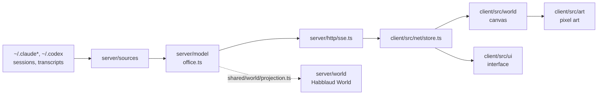

# Arquitetura

Mapa curto para quem chega agora. O Habblaud é um servidor Node sem dependências de runtime que lê os arquivos que as
ferramentas de IA já gravam, monta um modelo do escritório e o transmite ao navegador, que desenha tudo em canvas. O
código é TypeScript e o build usa Vite (cliente) e esbuild (`scripts/build-server.mjs`).

## O fluxo de dados

1. **Fontes** (`server/sources/`) leem, somente leitura, os arquivos das sessões abertas e das transcrições — Claude
   Code, Codex e também Gemini/Antigravity, OpenCode e Aider. O registro
   ([`registry.ts`](../server/sources/registry.ts)) diz quem está no escritório; o watcher
   ([`watcher.ts`](../server/sources/watcher.ts)) segue o fim dos `.jsonl`; `subagents.ts`, `shells.ts` e `github.ts`
   tiram dali subagentes, comandos em andamento e eventos de PR/CI.
2. **Modelo** ([`server/model/office.ts`](../server/model/office.ts)) junta tudo em agentes, salas, feed e avisos,
   com `rooms.ts` (nomes de sala) e `names.ts` (nomes de personagem).
3. **API** ([`server/http/app.ts`](../server/http/app.ts)) publica o snapshot por SSE em `GET /api/stream` e as rotas
   de detalhe, terminal, estatísticas, permissões, mensagens e World. `guard.ts` barra `Host`/`Origin` estranhos;
   `remote.ts` é a porta do celular, com login e TLS.
4. **Cliente** ([`client/src/net/store.ts`](../client/src/net/store.ts)) assina o SSE e notifica a interface; o
   desenho fica em [`client/src/world/`](../client/src/world/index.ts) com a arte procedural de
   [`client/src/art/`](../client/src/art/index.ts), a interface em [`client/src/ui/`](../client/src/ui/index.ts) e o
   som sintetizado em [`client/src/audio/`](../client/src/audio/synth.ts). O ponto de entrada é
   [`client/src/main.ts`](../client/src/main.ts), que carrega o dicionário do idioma antes do app.

## Os diretórios

| Pasta | O que tem |
| --- | --- |
| [`server/http/`](../server/http/app.ts) | Rotas HTTP, SSE, guard, estáticos, terminal, estatísticas, timelapse e a porta remota. |
| [`server/sources/`](../server/sources/registry.ts) | Leitura das sessões e transcrições de cada ferramenta, com `source.ts` como contrato comum. |
| [`server/model/`](../server/model/office.ts) | O estado do escritório (agentes, salas, feed, avisos) e os nomes. |
| [`server/world/`](../server/world/uplink.ts) | Conta e prédio do Habblaud World: `service.ts`, `uplink.ts` (WebSocket), `viewer.ts` (cidade), `social.ts`. |
| [`server/`](../server/index.ts) (demais) | `permissions/`, `messages/`, `pty/`, `spawn/`, `deliveries/`, `dictation/`, `remote/`, `history/`, `updates/`, `accounts/` e `codex/`. |
| [`shared/`](../shared/types.ts) | Contratos (`types.ts`), atividades, aparência, i18n e o simulador de demonstração. |
| [`shared/locales/`](../shared/locales/en.ts) | Traduções de `en`, `es` e `fr`; o português é a chave, escrita no próprio `tr()`. |
| [`shared/world/`](../shared/world/projection.ts) | Protocolo, schema, geometria da cidade e a projeção do prédio (o único lugar que monta o pacote). |
| [`client/src/`](../client/src/app.ts) | `ui/`, `world/`, `art/`, `net/` e `audio/`. |
| [`scripts/`](../scripts/docker-up.ts) | Build, Docker, instaladores (`mod`, hooks, Codex, statusline), `remote-setup`, `release` e capturas. |
| [`mod/`](../mod/README.md) | O mod e os plugins de permissões e de mensagens que rodam dentro do Claude Code. |

## Onde ficam os invariantes

- **Todo texto visível passa por `tr()`** ([`shared/i18n.ts`](../shared/i18n.ts)). A chave é o texto em português;
  valores entram por lacunas numeradas (`tr('Lendo {0}', [arquivo])`). Texto novo sem tradução aparece em português, e
  `npm run i18n:check` lista o que falta e o que sobrou.
- **Mudança visível entra em "Não lançado"** no [`CHANGELOG.md`](../CHANGELOG.md). O texto de cada versão vira as
  notas da release (`npm run release`), e um teste falha se a versão do `package.json` não tiver seção.
- **Dados verdadeiros no World**: `shared/world/` e `server/world/` decidem o que sai da máquina. Nada de andares,
  agentes, status, tokens ou personagens inventados — isso quebra os Termos de Uso e bane a conta. Campo novo no
  pacote exige `protocol.ts`, `schema.json`, `projection.ts`, [`docs/world/privacidade.md`](world/privacidade.md) e os
  testes no mesmo pull request. Leia antes o [`shared/world/README.md`](../shared/world/README.md).
- **Somente leitura nas pastas das ferramentas**: só os instaladores que você roda (`mod:install`, `usage:install`,
  `hooks:install`, `codex:install`) escrevem, sempre com backup.
- **Sem dependências de runtime**: o servidor usa só módulos do Node. As dependências de `package.json` são de build e
  de desenvolvimento.

## Por onde seguir

- Instalação, uso e cada recurso: [README](../README.md) ou [README.pt-BR](../README.pt-BR.md).
- Servidor em detalhe (fontes, rotas, terminal, World): [`server/README.md`](../server/README.md).
- Como contribuir, rodar os testes e o checklist de pull request: [`CONTRIBUTING.md`](../CONTRIBUTING.md).
- Segurança e o que sai da máquina: [`SECURITY.md`](../SECURITY.md) e [`docs/world/privacidade.md`](world/privacidade.md).
